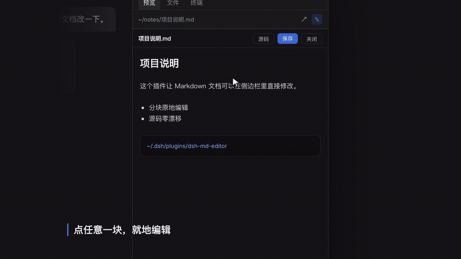

# dsh-md-editor

> Edit Markdown **right inside the DeepSeek Harness sidebar** — click any block, edit it in place, zero source drift.


**English** | [中文](README.md)



> Full demo video: [docs/demo.mp4](docs/demo.mp4) (30 s)

---

## What this is

DSH's document preview is **read-only**. The official package says it itself — *"Preview, not editing"* — and the browser-side `workspace-files` service explicitly exposes no mutation operation. Editing a Markdown file you just opened means switching to another editor.

This plugin closes that gap: it adds a pencil button to the document preview header. Click it and an editor covers the preview pane, so you can click any rendered block and edit it right there.

## Features

| Capability | What it does |
|---|---|
| **In-place block editing** | Click any block in the rendered output (heading / paragraph / list / code fence) and it turns into an editor on the spot |
| **Zero source drift** | You edit that block's **Markdown source**. No HTML → Markdown round-trip, so `*` lists stay `*`, escapes survive, tables are never reflowed |
| **Live preview** | Reuses DSH's built-in `MarkdownText` component — the exact renderer used by the official preview |
| **Full source mode** | The "源码 / Source" button in the header switches to whole-document plain-text editing for bigger rewrites |
| **Atomic writes** | Writes to a temp file in the same directory, then `rename`s it over the target, preserving the original permission bits |
| **Conflict protection** | Requests carry `mtimeMs`; if the file changed underneath you, the write returns 409 and asks before overwriting |
| **Shortcuts** | `⌘/Ctrl + S` saves (inside a block it commits that block first), `Esc` closes / cancels the current block |

Supported extensions: `.md` / `.markdown` / `.txt`.

## Install

> Requires the DeepSeek Harness desktop app (currently targeting 0.2.x).

**1. Get the code**

```bash
git clone https://github.com/yadnuses/dsh-md-editor.git ~/Downloads/dsh-md-editor
ln -sfn ~/Downloads/dsh-md-editor ~/.dsh/plugins/dsh-md-editor
```

**2. Register it in your profile**

Edit `~/.dsh/profiles/desktop/package.json`:

```jsonc
{
  "dependencies": {
    // use your own absolute path
    "dsh-md-editor": "link:/Users/your-name/.dsh/plugins/dsh-md-editor"
  },
  "dsh": {
    "profile": {
      "bundles": [
        // …keep your existing bundles…
        "dsh-md-editor"
      ]
    }
  }
}
```

**3. Install with the pnpm bundled with DSH**

```bash
cd ~/.dsh/profiles/desktop

ELECTRON_RUN_AS_NODE=1 "/Applications/DeepSeek Harness.app/Contents/MacOS/DeepSeek Harness" \
  --expose-internals "/Applications/DeepSeek Harness.app/Contents/Resources/runtime/primary-runtime/dependencies/pnpm/bin/pnpm.mjs" \
  install
```

Then refresh the DSH window once. (With profile HMR enabled it usually picks up on its own.)

> Back up `package.json` / `cordis.patch.yml` / `pnpm-lock.yaml` before editing them.

## Usage

1. Open a `.md` file from the file tree (`⌘P`) — it previews in the right sidebar;
2. Click the **pencil button** in the preview header;
3. Click the paragraph you want to change — it becomes an editor holding that block's Markdown source;
4. `blur` or `⌘+Enter` commits and re-renders it; `Esc` cancels that block;
5. `⌘/Ctrl + S` saves. The DSH preview refreshes automatically through its file watcher.

## Security boundaries

The plugin deliberately keeps a small surface:

- Routes only accept **loopback** requests (`127.0.0.1` / `::1`);
- Only writes to **existing regular files** — symlinks, directories and devices are rejected;
- Extension allow-list `.md` / `.markdown` / `.txt`, max **4 MiB** per file;
- Writes are **atomic replacements** that preserve permission bits; conflicts are never silently overwritten;
- Registers no tools, injects no prompt sections, reads no session data, and patches no DSH internals.

## How it works

Two halves, both built on DSH's public extension points:

```
┌───────────────────────── browser · lib/client.js ────────────────────────┐
│ window.__ModuleLoader__.load(...)                                        │
│   ctx.slots.inject("sidebar.right.tab.document.actions", ...)            │
│     └─ mounts the "edit" button in the document preview header           │
│   EditorPanel (portal to document.body)                                  │
│     ├─ split into blocks by blank lines → render each with               │
│     │  @deepseek-ai/dsh-client-ui-primitives · MarkdownText              │
│     └─ click a block → textarea with its source → splice back on commit   │
└──────────────────────────────────────────────────────────────────────────┘
                                   │ fetch /md-editor/{read,write}
┌───────────────────────── host · lib/index.js ────────────────────────────┐
│ ctx.inject(["webServer"])                                                │
│   webServer.register({ kind: "exact", path: "/md-editor/read", ... })     │
│   webServer.register({ kind: "exact", path: "/md-editor/write", ... })    │
│     └─ validate → atomic write → return mtime                            │
└──────────────────────────────────────────────────────────────────────────┘
```

A few gotchas worth knowing (all learned the hard way):

- `MarkdownText` is a **`React.memo(...)` object**, not a function — checking `typeof x === "function"`
  silently disables the renderer;
- The desktop page's origin is `dsh-app://app/`; non-static paths are forwarded to the host by the
  Electron main process, so relative `fetch` works;
- Block splitting has to respect **blank lines inside fenced code**, **loose lists**, and
  **indented nesting**, or it will tear a block apart.

### Why not WYSIWYG

Rich-text editing has to deserialize HTML back into Markdown, which inevitably rewrites your
formatting. This plugin edits the **original source of the block**, so the file is byte-identical
except for what you actually changed — which matters more for notes and docs repos than "feels fancy".

## Project structure

```
dsh-md-editor/
├── package.json          # dsh.bundle.patch + dsh.client(platform: web)
├── cordis.patch.yml      # loader row: id md-editor / name dsh-md-editor
├── lib/
│   ├── index.js          # host: /md-editor loopback routes (read / write / health)
│   └── client.js         # browser: header button + in-place editor
├── docs/                 # demo video, gif, screenshots
├── README.en.md          # this file
└── README.md             # 中文
```

## Development

The plugin is **plain JavaScript with no build step** — `lib/client.js` is hand-written against
DSH's `window.__ModuleLoader__` format; edit it and let DSH hot-reload.

```bash
node --check lib/index.js && node --check lib/client.js
```

The browser half is covered by jsdom + React 18 tests: slot registration, button rendering, opening
the panel, block splitting, click-to-edit, commit, `⌘S` inside a block, 409 conflict overwrite, and
CRLF restoration.

## Known limitations

- **Per-block rendering**: reference-style link/footnote definitions that live in another block
  (`[x]: url`) may not resolve;
- Inside a block you see **source**, not rich text;
- The preview and the editor **do not scroll in sync**;
- Targets DSH **0.2.x** client internals; major DSH upgrades will need follow-up work.

## Uninstall

```bash
# 1. remove dsh-md-editor from ~/.dsh/profiles/desktop/package.json
#    (one line in dependencies, one in dsh.profile.bundles)
# 2. reinstall
cd ~/.dsh/profiles/desktop && pnpm install
# 3. drop the symlink
rm ~/.dsh/plugins/dsh-md-editor
```

## License

[MIT](LICENSE)

---

> Community plugin — not an official DeepSeek product. Evaluate the risk yourself and back up your
> profile configuration before installing.
