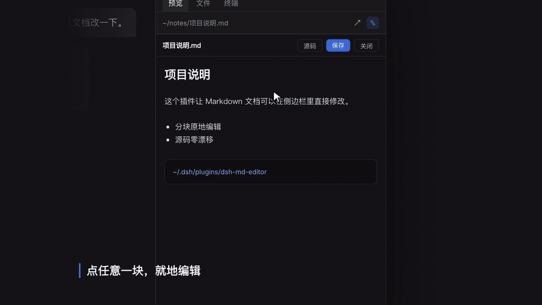

# dsh-md-editor

> 在 **DeepSeek Harness** 的右侧边栏，直接编辑 Markdown —— 点哪改哪，源码零漂移。




> 完整演示视频：[docs/demo.mp4](docs/demo.mp4)（30 秒）

---

## 这是什么

DSH 的文档预览是**只读**的 —— 官方包自己写着 *"Preview, not editing"*，浏览器端的
`workspace-files` 服务也明确不提供任何写操作。想改一篇刚打开的 Markdown，只能切到别的编辑器。

这个插件补上这段路：在文档预览头部加一个铅笔按钮，点开后**编辑器精确覆盖在预览区上**，
直接在渲染后的文档里点任意一段就能改。

## 功能

| 能力 | 说明 |
|---|---|
| **按块原地编辑** | 点渲染结果里的任意一块（标题 / 段落 / 列表 / 代码块），它就地在原地变成编辑框 |
| **源码零漂移** | 改的是这一块的 **Markdown 源码**，不做 HTML → Markdown 回写，不会把你的 `*` 列表变成 `-`、不会丢转义、不会重排表格 |
| **实时预览** | 复用 DSH 内置的 `MarkdownText` 组件（与官方预览同一套渲染），边改边看 |
| **整篇源码模式** | 头部「源码」按钮切换成纯文本整篇编辑，适合大改 |
| **原子写入** | 同目录临时文件 + `rename` 替换，保留原文件权限位 |
| **冲突保护** | 请求带 `mtimeMs`，文件被外部改动过会返回 409 并询问是否覆盖 |
| **快捷键** | `⌘/Ctrl + S` 保存（块内按会先提交当前块）、`Esc` 关闭 / 取消当前块 |

支持 `.md` / `.markdown` / `.txt`。

## 安装

> 需要 DeepSeek Harness 桌面端（当前适配 0.2.x）。

**1. 把仓库放到本机**

```bash
git clone https://github.com/yadnuses/dsh-md-editor.git ~/Downloads/dsh-md-editor
ln -sfn ~/Downloads/dsh-md-editor ~/.dsh/plugins/dsh-md-editor
```

**2. 在 profile 里登记**

编辑 `~/.dsh/profiles/desktop/package.json`：

```jsonc
{
  "dependencies": {
    // 路径换成你自己的绝对路径
    "dsh-md-editor": "link:/Users/你的用户名/.dsh/plugins/dsh-md-editor"
  },
  "dsh": {
    "profile": {
      "bundles": [
        // ……原有 bundles 保持不变……
        "dsh-md-editor"
      ]
    }
  }
}
```

**3. 用 DSH 自带的 pnpm 安装**

```bash
cd ~/.dsh/profiles/desktop

ELECTRON_RUN_AS_NODE=1 "/Applications/DeepSeek Harness.app/Contents/MacOS/DeepSeek Harness" \
  --expose-internals "/Applications/DeepSeek Harness.app/Contents/Resources/runtime/primary-runtime/dependencies/pnpm/bin/pnpm.mjs" \
  install
```

装完回到 DSH 刷新一次窗口即可（profile 开了 HMR 时通常会自动生效）。

> 改完配置前建议先备份 `package.json` / `cordis.patch.yml` / `pnpm-lock.yaml`。

## 使用

1. 用文件树（`⌘P`）打开一个 `.md`，它会在右侧边栏预览；
2. 点预览头部的**铅笔按钮**；
3. 点你想改的那一段 → 就地变成编辑框（内容是这一块的 Markdown 源码）；
4. `失焦` / `⌘+Enter` 提交并渲染回去，`Esc` 取消这一块；
5. `⌘/Ctrl + S` 保存；保存后 DSH 的预览会因文件监听自动刷新。

## 安全边界

插件刻意把能力收得很小：

- 路由只接受**回环地址**（`127.0.0.1` / `::1`）的请求；
- 只写**已存在**的普通文件，拒绝符号链接、目录、设备；
- 扩展名白名单 `.md` / `.markdown` / `.txt`，单文件上限 **4 MiB**；
- 写入是**原子替换**，保留权限位；冲突不静默覆盖；
- 不注册工具、不注入提示词、不读写会话数据、不改 DSH 内核。

## 实现原理

两半组成，全部走 DSH 的公开扩展点：

```
┌───────────────────────── 浏览器端 lib/client.js ─────────────────────────┐
│ window.__ModuleLoader__.load(...)                                        │
│   ctx.slots.inject("sidebar.right.tab.document.actions", ...)            │
│     └─ 在文档预览头部挂「编辑」按钮                                       │
│   EditorPanel（portal 到 body）                                          │
│     ├─ 按空行分块 → 每块用 @deepseek-ai/dsh-client-ui-primitives          │
│     │               的 MarkdownText 渲染（与官方预览同源）                 │
│     └─ 点块 → 换成该块源码的 textarea → 提交后拼回全文                    │
└─────────────────────────────────────────────────────────────────────────┘
                                   │ fetch /md-editor/{read,write}
┌───────────────────────── 宿主端 lib/index.js ───────────────────────────┐
│ ctx.inject(["webServer"])                                               │
│   webServer.register({ kind: "exact", path: "/md-editor/read", ... })    │
│   webServer.register({ kind: "exact", path: "/md-editor/write", ... })   │
│     └─ 校验 → 原子写 → 返回 mtime                                        │
└─────────────────────────────────────────────────────────────────────────┘
```

几个关键点（也是踩过的坑）：

- `MarkdownText` 是 `React.memo(...)` 返回的**对象**，判断可用性不能只认 `function`；
- 桌面端页面 origin 是 `dsh-app://app/`，非静态路径由 Electron 主进程转发到宿主，所以相对
  路径 `fetch` 可用；
- 分块要照顾**围栏代码块内部的空行**、**松散列表**和**缩进嵌套**，否则会把一块切碎。

### 为什么不做富文本 WYSIWYG

富文本编辑要把 HTML 反序列化回 Markdown，必然悄悄改写你的写法。这个插件改的是**这一块的
原始源码**，源文件除你实际改动外一个字符都不变 —— 对笔记/文档仓库来说这比"看着爽"重要。

## 目录结构

```
dsh-md-editor/
├── package.json          # dsh.bundle.patch + dsh.client(platform: web)
├── cordis.patch.yml      # loader 行：id md-editor / name dsh-md-editor
├── lib/
│   ├── index.js          # 宿主端：/md-editor 回环路由（read / write / health）
│   └── client.js         # 浏览器端：头部按钮 + 原地编辑器
├── docs/                 # 演示视频、动图、截图
└── README.md
```

## 开发

插件是**纯 JavaScript**、零构建——`lib/client.js` 直接按 DSH 的 `window.__ModuleLoader__`
格式手写，改完让 DSH 热重载即可。

本地自测（不需要跑起整个 DSH）：

```bash
# 宿主路由逻辑
node --check lib/index.js && node --check lib/client.js
```

客户端部分用 jsdom + React 18 覆盖了：槽位注册、按钮渲染、打开面板、分块、点块编辑、
提交、块内 ⌘S、409 冲突覆盖、CRLF 还原等用例。

## 已知限制

- **分块渲染**：跨块的引用式链接/脚注定义（`[x]: url` 写在别的块里）可能不生效；
- **块内看到的是源码**，不是富文本；
- 预览与编辑区**滚动不同步**；
- 适配 DSH **0.2.x** 客户端内部结构，DSH 大版本升级后需要跟进。

## 卸载

```bash
# 1. 从 ~/.dsh/profiles/desktop/package.json 里删掉 dsh-md-editor
#    （dependencies 与 dsh.profile.bundles 各一行）
# 2. 重新安装
cd ~/.dsh/profiles/desktop && pnpm install
# 3. 删掉软链
rm ~/.dsh/plugins/dsh-md-editor
```

## License

[MIT](LICENSE)

---

> 社区插件，非 DeepSeek 官方产品。使用前请自行评估风险并备份你的 profile 配置。
